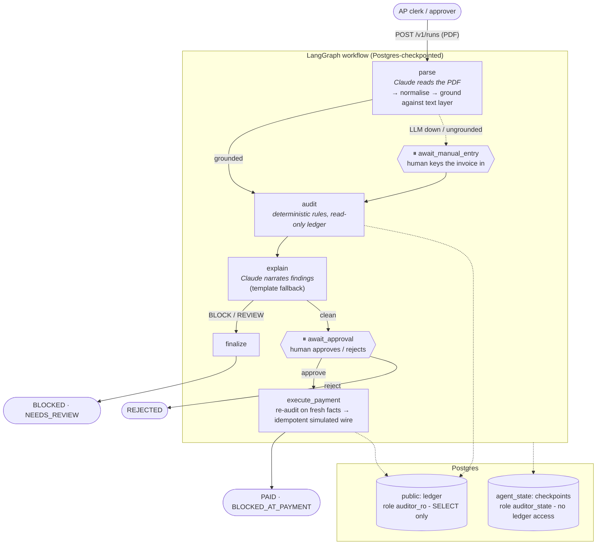

# Multi-Agent Finance Auditor


An accounts-payable auditor: upload a supplier invoice PDF, and a LangGraph agent workflow reads it with Claude,
checks it against the **contract** it was billed under and the **payment history** in the ERP, explains what it
found, and stops anomalous payments before money moves. Clean invoices pause for a human to approve; nothing is
ever paid autonomously.

> **Status:** M0–M3 complete - deterministic audit core, read-only ledger, HTTP API, Docker stack, and the
> LangGraph agent workflow with HITL approval and deterministic fallbacks. See [Roadmap](#roadmap).

---

## Why this matters

Accounts-payable fraud and error are rarely sophisticated. They are a vendor billing $150/hr against a $120/hr
contract, the same invoice resubmitted with a new date, line items that don't add up to the stated subtotal, or an
email asking to "update our bank details". Each is trivially detectable **if** someone cross-references three
systems - the invoice, the contract, and the ledger - for every invoice. At volume, nobody does.

This system does it for every invoice, explains every finding with quantified evidence, and fails closed: if it
cannot verify something, it says so instead of approving.

| Finding | Severity | Example caught |
|---|---|---|
| `RATE_EXCEEDS_CONTRACT` | BLOCK | $150/hr billed vs $120/hr ceiling - overcharge $2,400.00 |
| `DUPLICATE_INVOICE` | BLOCK | Invoice KFC-9981 already PAID on 2026-09-18, resubmitted |
| `ARITHMETIC_MISMATCH` | BLOCK | Lines sum to 4,700.00; stated subtotal 4,970.00 (tax & total consistent with the wrong figure) |
| `PO_BUDGET_EXCEEDED` | BLOCK | 3,570.00 against 2,500.00 remaining on the PO |
| `REMIT_TO_MISMATCH` | BLOCK | Bank account differs from vendor master - business-email-compromise pattern |
| `POSSIBLE_DUPLICATE` | REVIEW | Same vendor and amount as a payment 5 days earlier |
| `VENDOR_UNKNOWN`, `PO_UNKNOWN`, `PO_VENDOR_MISMATCH`, `NO_CONTRACT`, `UNRESOLVED_LINE_ITEM` | BLOCK / REVIEW | Integrity failures: the facts needed for a check could not be established |

---

## Architecture



**Design decisions**

- **Rules own the verdict; LLMs read and explain.** An auditable decision must be reproducible from logged inputs.
  `evaluate()` is a pure function: same `ExtractedInvoice` + `LedgerFacts` → same verdict, every time. Claude
  transcribes documents and narrates findings; it never decides whether money moves.
- **The LLM reads, code interprets, the document is the ground truth.** The parser asks Claude for a flat,
  string-typed transcription (structured outputs); deterministic code normalises it, validates its shape, and
  checks that every identifier and amount actually appears in the PDF's own text layer. A value the model
  "read" that isn't on the page sends the invoice to a human instead of into the audit. The prompt forbids
  correcting inconsistent figures - and if the model does "fix" the arithmetic anyway, the fix isn't on the page,
  so grounding rejects it. Fraud can be routed to a human; it can't be silently erased.
- **Degrade, don't crash.** No API key, a timeout, a refusal, a schema violation: parsing falls back to
  human data entry, explanations to a deterministic template. The run records every degradation. With no LLM at
  all the system still works end to end - CI proves it on every push.
- **Prompt injection has nowhere to go.** Invoice text reaches only the parser, whose output is grounded and then
  judged by rules. The explainer sees only the engine's structured findings, never document text, and cannot
  change the verdict.
- **Human in the loop, done properly.** LangGraph `interrupt()` pauses clean invoices for approval; the Postgres
  checkpointer means a pending approval survives restarts and deploys. Four-eyes rule: whoever keyed an invoice
  in by hand cannot approve it.
- **Time-of-check ≠ time-of-use.** Approval can come days after the audit, so payment re-audits against fresh
  ledger facts first. A duplicate paid in the meantime is caught (`BLOCKED_AT_PAYMENT`).
- **Money moves at most once, to the right place.** Payment is idempotent on the run id (LangGraph may re-run
  a node after a crash) and goes to the account on the vendor master record, never the one printed on the invoice.
- **Fail closed.** "Couldn't check" never looks like "checked and clean": unknown vendors, missing contracts and
  ambiguous line items block or escalate.
- **Shape validation ≠ semantic validation.** Pydantic rejects malformed data but deliberately *accepts* an
  invoice whose subtotal contradicts its lines - otherwise fraud would surface as a 422 instead of a finding.
- **Least privilege, both ways.** The ledger role can't write; the checkpoint role can't read the ledger. The admin
  password never reaches the API container, which runs non-root on a read-only filesystem.
- **Plain-JSON state.** Checkpoints hold only JSON - models are re-validated on read, and derived fields such as
  a finding's severity are recomputed rather than trusted, so a tampered checkpoint can't relabel a BLOCK.
- **Money is never a float.** `Decimal` in Python, integer cents in the database.

---

## Quickstart (Docker)

Requires Docker with Compose v2.

```bash
git clone https://github.com/zainabbas14/multi-agent-finance-auditor.git
cd multi-agent-finance-auditor
cp .env.example .env     # set the three passwords; optionally ANTHROPIC_API_KEY
docker compose up --build
```

Interactive API docs: <http://localhost:8000/docs>

### The agent workflow

```bash
G=tests/mock_data/generated

# 1. Upload an invoice PDF
RUN=$(curl -s -F "file=@$G/invoices/S01_clean_services.pdf;type=application/pdf" localhost:8000/v1/runs)
ID=$(echo "$RUN" | jq -r .run_id); echo "$RUN" | jq '{status, verdict, narrative, degradations}'
```

- **With `ANTHROPIC_API_KEY` set:** Claude parses the PDF; the clean invoice stops at `AWAITING_APPROVAL`.
- **Without a key:** the run degrades to `NEEDS_MANUAL_ENTRY`. Key the invoice in (here, from the fixture):

  ```bash
  jq '{entered_by: "clerk.bea", invoice: .}' $G/requests/S01_clean_services.json \
    | curl -s -X POST localhost:8000/v1/runs/$ID/extraction -H 'content-type: application/json' -d @- | jq .status
  ```

```bash
# 2. Approve (a different person from whoever keyed it in)
curl -s -X POST localhost:8000/v1/runs/$ID/decision -H 'content-type: application/json' \
  -d '{"approved": true, "approver": "ap.manager"}' | jq '{status, payment}'
```

Upload `S03_rate_overcharge.pdf` or `S07_remit_to_changed.pdf` instead and the run stops at `BLOCKED` with
quantified findings - there is no approval path for it.

### The deterministic endpoint

`POST /v1/audits` takes an already-extracted invoice (JSON) and returns the rule engine's verdict directly, with no
LLM involved:

```bash
curl -s -X POST localhost:8000/v1/audits -H 'content-type: application/json' \
  -d @tests/mock_data/generated/requests/S05_arithmetic_mismatch.json | jq
```

Reset all state with `docker compose down -v`.

---

## Local development

```bash
python3.12 -m venv .venv && source .venv/bin/activate
pip install -r requirements-dev.txt && pip install -e . --no-deps

ruff check . && ruff format --check . && mypy && pytest     # the CI gate, locally (no LLM calls)

# Include the Postgres half of the suite (any superuser DSN; tests create and drop their own database):
docker compose up -d postgres
AUDITOR_TEST_DATABASE_URL=postgresql://erp_admin:<POSTGRES_PASSWORD>@localhost:5432/postgres pytest

# Live extraction eval against the real Claude API (costs tokens; never runs in CI):
ANTHROPIC_API_KEY=sk-ant-... pytest -m live -s

# Run the API against the local SQLite ledger:
uvicorn auditor.api.app:create_app --factory --reload
```

Configuration is environment-only (prefix `AUDITOR_`), validated at startup; see [`.env.example`](.env.example).
No secret has a default value, and the database URL is held as a `SecretStr` so it never renders in logs.

---

## Test data

Real AP data is confidential, so the repository ships a deterministic, internally consistent synthetic world,
generated from a single source of truth (`tests/mock_data/fixtures.py`):

- **8 invoice PDFs** in three deliberately different vendor layouts (different column orders, labels, date formats,
  and whether item codes are printed at all), so a parser cannot overfit one template.
- **3 contract PDFs** following the [CUAD](https://www.atticusprojectai.org/cuad) clause taxonomy, with rate
  ceilings in Exhibit A - pages away from the clause that makes them binding, as in real agreements.
- **An ERP ledger** (SQLite + a generated Postgres seed) with background noise that is guaranteed not to create
  unexpected findings.
- **A golden file** (`expected_outcomes.json`) with the expected verdict, findings, and field-level extraction
  ground truth for every scenario.

`python -m tests.mock_data.build` regenerates everything byte-identically; CI fails if the committed artifacts are
stale.

---

## Repository layout

```
src/auditor/
  domain/          enums (findings, severities, verdicts) and Pydantic models
  rules/engine.py  gather_facts() [I/O] + evaluate() [pure]
  agents/          Document Parser (Claude + grounding) and Explainer (Claude + template fallback)
  workflow/        LangGraph state machine, run service, checkpointer wiring
  llm/             StructuredLLM port + Anthropic adapter (structured outputs)
  documents/       content-addressed PDF store, text-layer extraction
  payments.py      idempotent simulated payment gateway
  ports.py         LedgerReader protocol (read-only)
  adapters/        SQLite and Postgres ledger implementations, factory
  api/app.py       FastAPI app factory, middleware, routes
  config.py        pydantic-settings
  logging_setup.py structured JSON logging with request IDs
db/postgres/       schema, read-only ledger role, checkpoint role (docker-entrypoint-initdb.d)
tests/             unit, golden end-to-end (both backends), workflow (scripted fake LLM), API, live eval
.github/workflows/ lint → types → tests (SQLite + Postgres) → fixture freshness → docker compose smoke test
                   (golden scenarios over HTTP, degraded agent path, restart-surviving approval, four-eyes)
```

---

## Roadmap

- [x] **M0** Deterministic multi-modal test data with golden outcomes
- [x] **M1** Domain model, pure rule engine, read-only ledger, CI
- [x] **M2** Settings, structured logging, FastAPI, Postgres, Docker Compose
- [x] **M3** LangGraph workflow: Claude document parser with grounding, explainer, HITL approval with Postgres
      checkpoints, manual-entry fallback, four-eyes, pre-payment re-audit, idempotent simulated payment
- [ ] **M4** Contract agent (Claude reads contract PDFs → rate card, cross-checked against the ERP mirror),
      LLM-proposed line-item mappings for human confirmation, evaluation harness with real CUAD contracts
- [ ] **M5** Authentication and roles for approvers, append-only audit log, async job queue for uploads,
      durable payment outbox
