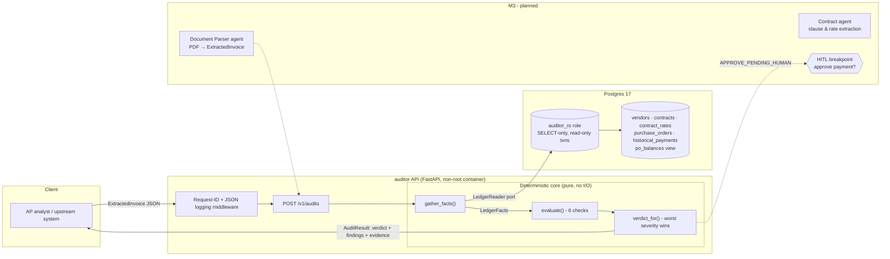

# Multi-Agent Finance Auditor


An accounts-payable auditor that checks every supplier invoice against the **contract** it was billed under and the
**payment history** in the ERP, and stops anomalous payments before money moves. Clean invoices are routed to a human
for approval; nothing is ever paid autonomously.

> **Status:** the deterministic audit core, read-only ledger, HTTP API and Docker stack are complete (M0–M2).
> The LangGraph agent layer (document parsing, contract reading, HITL approval) is the next milestone - see
> [Roadmap](#roadmap). This README describes what exists, not what is planned.

---

## Why this matters

Accounts-payable fraud and error are rarely sophisticated. They are a vendor billing $150/hr against a $120/hr
contract, the same invoice resubmitted with a new date, line items that don't add up to the stated subtotal, or an
email asking to "update our bank details". Each is trivially detectable **if** someone cross-references three
systems - the invoice, the contract, and the ledger - for every invoice. At volume, nobody does.

This system does it for every invoice, explains every finding with quantified evidence, and fails closed: if it
cannot verify something, it says so instead of approving.

| Finding | Severity | Example caught |
|---|---|---|
| `RATE_EXCEEDS_CONTRACT` | BLOCK | $150/hr billed vs $120/hr ceiling - overcharge $2,400.00 |
| `DUPLICATE_INVOICE` | BLOCK | Invoice KFC-9981 already PAID on 2026-09-18, resubmitted |
| `ARITHMETIC_MISMATCH` | BLOCK | Lines sum to 4,700.00; stated subtotal 4,970.00 (tax & total consistent with the wrong figure) |
| `PO_BUDGET_EXCEEDED` | BLOCK | 3,570.00 against 2,500.00 remaining on the PO |
| `REMIT_TO_MISMATCH` | BLOCK | Bank account differs from vendor master - business-email-compromise pattern |
| `POSSIBLE_DUPLICATE` | REVIEW | Same vendor and amount as a payment 5 days earlier |
| `VENDOR_UNKNOWN`, `PO_UNKNOWN`, `PO_VENDOR_MISMATCH`, `NO_CONTRACT`, `UNRESOLVED_LINE_ITEM` | BLOCK / REVIEW | Integrity failures: the facts needed for a check could not be established |

---

## Architecture



**Design decisions**

- **Rules own the verdict; LLMs will explain and assist.** An auditable decision must be reproducible from logged
  inputs. `evaluate()` is a pure function: same `ExtractedInvoice` + `LedgerFacts` → same verdict, every time. In M3,
  LLM agents produce those inputs and write the human-readable rationale; they never decide whether money moves.
- **Fail closed.** "Couldn't check" never looks like "checked and clean". A vendor with no contract is blocked, not
  waved through without a price check. Ambiguous line items are escalated, never guessed.
- **Shape validation ≠ semantic validation.** Pydantic rejects malformed data (negative money, sub-cent precision,
  NaN). It deliberately *accepts* an invoice whose subtotal contradicts its lines - otherwise the fraud the system
  exists to detect would surface as a 422 instead of a finding.
- **Read-only by construction, three layers deep.** The ledger port has no write methods; the app connects as a
  SELECT-only role; that role and the connection pool both force read-only transactions. CI verifies the role
  cannot write.
- **Money is never a float.** `Decimal` in Python, integer cents in the database.
- **Ports & adapters.** The core depends on a `LedgerReader` protocol. SQLite and Postgres adapters both implement
  it, and every ledger-backed test runs against both to prove parity.

---

## Quickstart (Docker)

Requires Docker with Compose v2.

```bash
git clone https://github.com/zainabbas14/multi-agent-finance-auditor.git
cd multi-agent-finance-auditor
cp .env.example .env            # then set POSTGRES_PASSWORD and AUDITOR_DB_RO_PASSWORD
docker compose up --build
```

- Interactive API docs: <http://localhost:8000/docs>
- Readiness: <http://localhost:8000/readyz>

Audit the arithmetic-mismatch scenario:

```bash
curl -s -X POST http://localhost:8000/v1/audits \
  -H 'content-type: application/json' \
  -d @tests/mock_data/generated/requests/S05_arithmetic_mismatch.json | jq
```

```json
{
  "invoice_number": "MIS-55902",
  "verdict": "BLOCK",
  "findings": [
    {
      "code": "ARITHMETIC_MISMATCH",
      "message": "Line items sum to 4,700.00 but stated subtotal is 4,970.00 (difference 270.00).",
      "evidence": { "line_sum": "4700.00", "stated_subtotal": "4970.00" },
      "severity": "BLOCK"
    }
  ],
  "rules_version": "2026.11-m1"
}
```

All eight scenario request bodies are in `tests/mock_data/generated/requests/`. Reset the database with
`docker compose down -v`.

---

## Local development

```bash
python3.12 -m venv .venv && source .venv/bin/activate
pip install -r requirements-dev.txt && pip install -e . --no-deps

ruff check . && ruff format --check . && mypy && pytest     # the CI gate, locally

# Include the Postgres half of the suite (any superuser DSN; tests create and drop their own database):
docker compose up -d postgres
AUDITOR_TEST_DATABASE_URL=postgresql://erp_admin:<POSTGRES_PASSWORD>@localhost:5432/postgres pytest

# Run the API against the local SQLite ledger:
uvicorn auditor.api.app:create_app --factory --reload
```

Configuration is environment-only (prefix `AUDITOR_`), validated at startup; see [`.env.example`](.env.example).
No secret has a default value, and the database URL is held as a `SecretStr` so it never renders in logs.

---

## Test data

Real AP data is confidential, so the repository ships a deterministic, internally consistent synthetic world,
generated from a single source of truth (`tests/mock_data/fixtures.py`):

- **8 invoice PDFs** in three deliberately different vendor layouts (different column orders, labels, date formats,
  and whether item codes are printed at all), so a parser cannot overfit one template.
- **3 contract PDFs** following the [CUAD](https://www.atticusprojectai.org/cuad) clause taxonomy, with rate
  ceilings in Exhibit A - pages away from the clause that makes them binding, as in real agreements.
- **An ERP ledger** (SQLite + a generated Postgres seed) with background noise that is guaranteed not to create
  unexpected findings.
- **A golden file** (`expected_outcomes.json`) with the expected verdict, findings, and field-level extraction
  ground truth for every scenario.

`python -m tests.mock_data.build` regenerates everything byte-identically; CI fails if the committed artifacts are
stale.

---

## Repository layout

```
src/auditor/
  domain/          enums (findings, severities, verdicts) and Pydantic models
  rules/engine.py  gather_facts() [I/O] + evaluate() [pure]
  ports.py         LedgerReader protocol (read-only)
  adapters/        SQLite and Postgres implementations, factory
  api/app.py       FastAPI app factory, middleware, routes
  config.py        pydantic-settings
  logging_setup.py structured JSON logging with request IDs
db/postgres/       schema and read-only role (docker-entrypoint-initdb.d)
tests/             unit, golden end-to-end (both backends), API, mock-data integrity
.github/workflows/ lint → types → tests (SQLite + Postgres) → fixture freshness → docker compose smoke test
```

---

## Roadmap

- [x] **M0** Deterministic multi-modal test data with golden outcomes
- [x] **M1** Domain model, pure rule engine, read-only ledger, CI
- [x] **M2** Settings, structured logging, FastAPI, Postgres, Docker Compose
- [ ] **M3** LangGraph agents: Document Parser (PDF → `ExtractedInvoice`), Contract agent, LLM explainer;
      deterministic fallback on tool failure; HITL interrupt with a Postgres checkpointer
- [ ] **M4** Evaluation harness: per-field extraction accuracy and verdict accuracy on the golden set, plus real
      CUAD contracts for clause extraction
- [ ] **M5** Simulated payment execution behind the approval gate, idempotency keys, append-only audit log
